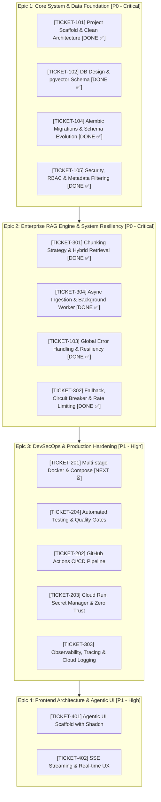

# 🚀 Mid-Level Software Engineer Transformation Sprint (Enterprise FDE Edition)

หลักสูตรจำลองการทำงานจริง (Agile/Kanban) เพื่อ Reskill สู่ระดับ **Mid-Level Engineer** โดยเน้นไปที่ **Clean Architecture, Mission-Critical Stability, DevSecOps, และการ Orchestrate AI Tools (Antigravity Pro)**

**Capstone Project:** `Enterprise AI Document RAG & Agentic System`  
(ระบบ AI ถามตอบและประมวลผลเอกสารภายในองค์กรที่พร้อมรองรับ Production สเกลองค์กร)

---

## 🛠️ Locked-in Tech Stack & Ecosystem

*   **Backend:** Python 3.11+ (FastAPI, SQLAlchemy, Pydantic v2)
*   **Frontend:** React (Vite) + TypeScript + Tailwind CSS + Shadcn UI
*   **Database & Vector Store:** PostgreSQL 16+ with `pgvector` extension
*   **Database Migrations:** Alembic
*   **Background Tasks / Worker:** FastAPI BackgroundTasks / Task Queue
*   **Testing Suite:** `pytest`, `pytest-asyncio`, `httpx` (with LLM Mocking)
*   **Cloud & Infrastructure:** Google Cloud Platform (Cloud Run, Artifact Registry, Secret Manager), Docker
*   **Security & Network:** Cloudflare Zero Trust (Access), GCP IAM & Service Accounts
*   **AI Engine:** Google Gemini API (gemini-1.5-pro / flash) + Antigravity Pro Agent

---

## 📋 The Kanban Board (Curriculum Tickets)



---

### Epic 1: Core System & Data Foundation [Priority: P0 - Critical]
*เปลี่ยน Mindset จากการเขียนสคริปต์เดี่ยว เป็นการวางโครงสร้างระบบที่รองรับการเติบโตและการเปลี่ยนผ่านข้อมูลอย่างปลอดภัย*

*   **[TICKET-101] Enterprise Project Scaffold & Clean Architecture (Decoupled Layering) [DONE ✅]**
    *   **Mapping Concept (Enterprise Modular Monolith & Clean Architecture):**
        *   **Multi-Tenancy Strategy:** Shared Database with Department Column & Row-Level Filtering (ง่ายต่อการ Migrate ด้วย Alembic และทำ Vector Metadata Filter ได้ปลอดภัย 100%)
        *   **Module Boundary:** แต่ละแผนก/โดเมนจะอยู่ภายใต้ `modules/<department>/` มีครบทุก Layer ภายในตัว (High Cohesion)
        *   **Controllers** $\rightarrow$ `modules/<dept>/controllers/` (จัดการ HTTP Route, Status Code, และ Dependency Injection)
        *   **Request / Response DTOs** $\rightarrow$ `modules/<dept>/dtos/requests/` และ `dtos/responses/` (Pydantic v2 สไตล์ C#/Java Strict Validation & Masking)
        *   **Interfaces / Contracts** $\rightarrow$ `modules/<dept>/interfaces/` (ใช้ `abc.ABC` กำหนด Service/Repo Contract รองรับ Inversion of Control & Mocking)
        *   **Services** $\rightarrow$ `modules/<dept>/services/` (Business Logic ล้วนของแผนกนั้นๆ)
        *   **Repositories** $\rightarrow$ `modules/<dept>/repositories/` (Data Access Layer เฉพาะโมดูล)
        *   **Shared Kernel** $\rightarrow$ `shared/` (Core AI Engine, Gemini Client, Shared DTOs, Background Tasks)
    *   **Standardized API Response Wrapper:**
        *   บังคับใช้ Response Structure รูปแบบเดียวกันทั้งระบบ:
            ```json
            {
              "code": 200,
              "status": "success",
              "data": { ... },
              "errors": null,
              "meta": {
                "request_id": "req_uuid4",
                "timestamp": "2026-10-27T07:45:00Z"
              }
            }
            ```
    *   **Full Directory Structure Blueprint (Enterprise Modular Monolith - Department Slice):**
        ```text
        backend/
        ├── app/
        │   ├── core/                          # [Infrastructure Core]
        │   │   ├── config.py                  # Settings (pydantic-settings from .env)
        │   │   ├── database.py                # Async Engine, SessionLocal, Base
        │   │   ├── security.py                # JWT Token, Password Hash, RBAC
        │   │   └── exceptions.py              # Custom Exceptions & Global Exception Handlers
        │   │
        │   ├── shared/                        # [Shared Kernel & Cross-Cutting Concerns]
        │   │   ├── clients/                   # External Service Clients
        │   │   │   └── gemini_client.py       # Gemini API, Embedding & Circuit Breaker
        │   │   ├── dtos/                      # Shared DTOs
        │   │   │   ├── api_response.py        # Generic APIResponse[T] Envelope
        │   │   │   └── pagination_dto.py      # PageParams & PagedResult[T]
        │   │   ├── rag_engine/                # RAG Core Components
        │   │   │   ├── chunker.py             # Recursive & Semantic Chunking
        │   │   │   └── embedder.py            # Vector Embedding Generator
        │   │   └── tasks/                     # Background Worker Handlers
        │   │       └── ingestion_tasks.py     # PDF Parsing & Embedding Jobs
        │   │
        │   ├── modules/                       # [Domain & Department Modules (High Cohesion)]
        │   │   ├── auth/                      # Core Auth & User Management Module
        │   │   │   ├── controllers/           # auth_controller.py
        │   │   │   ├── dtos/
        │   │   │   │   ├── requests/          # LoginRequest, RegisterRequest
        │   │   │   │   └── responses/         # TokenResponse, UserProfileResponse
        │   │   │   ├── interfaces/            # IAuthService, IUserRepository
        │   │   │   ├── services/              # AuthService
        │   │   │   ├── repositories/          # UserRepository
        │   │   │   └── models/                # User (Role, Department, Tenant)
        │   │   │
        │   │   ├── documents/                 # Enterprise Document Management Module
        │   │   │   ├── controllers/           # documents_controller.py
        │   │   │   ├── dtos/
        │   │   │   │   ├── requests/          # DocumentUploadRequest, FilterDocumentRequest
        │   │   │   │   └── responses/         # DocumentDetailResponse, ChunkResponse
        │   │   │   ├── interfaces/            # IDocumentService, IDocumentRepository
        │   │   │   ├── services/              # DocumentService
        │   │   │   ├── repositories/          # DocumentRepository, ChunkRepository (pgvector)
        │   │   │   └── models/                # Document, DocumentChunk
        │   │   │
        │   │   ├── hr/                        # [Department Slice: HR] แผนกบุคคล (ตัวอย่างโมดูลแผนก)
        │   │   │   ├── controllers/           # hr_controller.py
        │   │   │   ├── dtos/
        │   │   │   │   ├── requests/          # HRPoliciesQueryRequest
        │   │   │   │   └── responses/         # HRKnowledgeResponse
        │   │   │   ├── interfaces/            # IHRService, IHRRepository
        │   │   │   ├── services/              # HRService
        │   │   │   ├── repositories/          # HRRepository
        │   │   │   └── models/                # HRPolicyMetadata
        │   │   │
        │   │   └── [future_departments]/      # เพิ่มแผนกใหม่ (เช่น finance, legal) ได้ไม่กระทบโมดูลอื่น
        │   │
        │   ├── api_router.py                  # รวม Router ของทุก Module เข้า Prefix /api/v1
        │   └── main.py                        # FastAPI Application Entrypoint
        ├── alembic/                           # Database Migrations (Shared DB + Department Column)
        ├── tests/                             # Test Suite (pytest)
        │   ├── modules/                       # Unit Tests แยกตามแต่ละโมดูล (Mock Repo/LLM 100%)
        │   └── integration/                   # Integration Tests สำหรับ pgvector & Real Endpoints
        ├── Dockerfile
        ├── docker-compose.yml
        └── README.md
        ```
*   **[TICKET-102] Advanced Database Design & Vector Store Schema [DONE ✅]**
    *   ออกแบบ Relational Schema: `departments` (Master Tenant Single Source of Truth), `users`, `documents`, `document_chunks`
    *   ตั้งค่า Extension `pgvector` และเลือก Index Strategy: **HNSW Index** (`vector_cosine_ops`, $m=16, ef\_construction=64$) สำหรับ Vector Embeddings (768 dims)
    *   ออกแบบ Query Optimization และป้องกันปัญหา N+1 Query ด้วย Explicit Eager Loading (`selectinload` / `joinedload`) และตั้งค่า `lazy="raise"` ป้องกัน Memory Leak
    *   สร้าง `IChunkRepository` & `ChunkRepository` สำหรับ Approximate Nearest Neighbor (ANN) Vector Similarity Search พร้อม Department Isolation และ Threshold filtering
*   **[TICKET-104] Alembic Migrations & Schema Evolution [DONE ✅]**
    *   ตั้งค่า Alembic ควบคุม Schema Versioning อย่างเข้มงวด (ห้ามใช้ `Base.metadata.create_all()` บน Production)
    *   ซ้อมกระบวนการ **Zero-Downtime Migration (Expand and Contract Pattern)** ผ่าน Migration `expand_add_classification_level`
    *   จัดทำ Migration Runbook: ทดสอบการรันสคริปต์ `alembic upgrade head --sql` และ `alembic downgrade` พร้อมผ่าน Automated Test Suite 100%
*   **[TICKET-105] Security, RBAC & Vector Metadata Filtering [DONE ✅]**
    *   สร้างระบบ Authentication ด้วย JWT Bearer Token และ Role-Based Access Control (`ADMIN`, `MANAGER`, `MEMBER`)
    *   **Data Leak Prevention:** ออกแบบ Vector Search ให้บังคับกรอง Metadata (`department`, `classification_level IN allowed_clearances`) ในคำสั่ง SQL ก่อนคำนวณ Cosine Similarity ทุกครั้ง
    *   ติดตั้ง Guard Dependencies: `get_current_user`, `require_roles`, และ Clearance Hierarchy (`PUBLIC` <= `INTERNAL` <= `CONFIDENTIAL` <= `RESTRICTED`) บน Controller ทุกจุด

---

### Epic 2: Enterprise RAG Engine & System Resiliency [Priority: P0 - Critical]
*หัวใจของระบบ AI องค์กร: ทำงานเร็ว ไม่ติด Timeout และทนทานต่อความล้มเหลวภายนอก*

*   **[TICKET-301] RAG Workflow & Chunking Strategy [DONE ✅]**
    *   สร้าง Ingestion Pipeline สำหรับตัดแบ่งเอกสาร (Recursive Character Chunking, Header-based Splitting พร้อม Overlap ที่เหมาะสม)
    *   เชื่อมต่อ Google Gemini Embedding API แปลงข้อความเป็น Vector 768 / 1536 มิติ
*   **[TICKET-304] Asynchronous Ingestion & Background Task Processing [DONE ✅]**
    *   แยกงานเอกสารขนาดใหญ่ (PDF Parsing + Chunking + Embedding) ออกจาก HTTP Request Cycle ป้องกัน **HTTP 504 Gateway Timeout**
    *   สร้างระบบติดตามสถานะงานประมวลผล (`QUEUED`, `PROCESSING`, `SUCCESS`, `FAILED`) พร้อม Error Log ที่ชัดเจน
*   **[TICKET-103] Global Error Handling & Resiliency [DONE ✅]**
    *   สร้าง Global Exception Handler ดักจับ Error ทั้งระบบ ไม่ให้มี Stack Trace ดิบหลุดออกไปหา Client
    *   ออกแบบ Custom Exceptions: `EntityNotFoundError`, `VectorServiceError`, `QuotaExceededError`
*   **[TICKET-302] AI API Fallback, Circuit Breaker & Rate Limiting [DONE ✅]**
    *   ทำ Retry Mechanism ด้วย Exponential Backoff with Jitter เพื่อรองรับ Transient Error (HTTP 429 / 503)
    *   ติดตั้ง **Circuit Breaker Pattern** หยุดยิง API ชั่วคราวเมื่อปลายทางมีปัญหาต่อเนื่อง
    *   ทำ Model Fallback (สลับจาก Gemini Pro สู่ Gemini Flash หรือ Local Fallback Message) และตั้ง Guardrail คุม Token Usage

---

### Epic 3: DevSecOps, Infrastructure & Production Hardening [Priority: P1 - High]
*ความสามารถที่แยก Mid-level ออกจาก Junior อย่างแท้จริง: นำระบบขึ้น Production ได้อย่างมั่นคงและปลอดภัย*

*   **[TICKET-201] Advanced Dockerization & Local Environment [NEXT ⏳]**
    *   เขียน Multi-stage `Dockerfile` สำหรับ Python เพื่อลดขนาด Container Image และตัด Build Tool ที่ไม่จำเป็นออก
    *   สร้าง `docker-compose.yml` จำลองสภาพแวดล้อม Local แบบครบวงจร (FastAPI App + PostgreSQL พร้อม `pgvector`)
*   **[TICKET-204] Automated Testing & Quality Gates**
    *   ติดตั้ง Test Suite ด้วย `pytest` และ `pytest-asyncio`
    *   สร้าง Unit Tests สำหรับ Business Logic และ Integration Tests สำหรับ API Endpoints
    *   ทำ **Mocking สำหรับภายนอก (Gemini API)** เพื่อให้ Test รันเร็ว สม่ำเสมอ และไม่เสียโควต้า API ใน CI Pipeline
*   **[TICKET-202] CI/CD Pipeline (GitHub Actions)**
    *   สร้าง Workflow ตรวจสอบ Code Quality อัตโนมัติ (Linting ด้วย `ruff`, Type Checking ด้วย `mypy`, Automated Testing)
    *   สร้าง Automated Build และ Push Container Image ไปยัง Google Cloud Artifact Registry เมื่อมี Merge Request
*   **[TICKET-203] Google Cloud Run & Cloudflare Zero Trust Integration**
    *   Deploy Backend Container แบบ Serverless บน Google Cloud Run พร้อมกำหนด Resource Limits (CPU/Memory/Concurrency)
    *   จัดการ Secrets ผ่าน **Google Cloud Secret Manager** ห้าม Hardcode เด็ดขาด
    *   ตั้งค่า Cloudflare Zero Trust (Access) คัดกรองสิทธิ์การเข้าถึง Service ภายในองค์กร
*   **[TICKET-303] System Observability, Tracing & Production Telemetry**
    *   วางระบบ Structured JSON Logging เชื่อมต่อกับ GCP Cloud Logging
    *   ติดตั้ง Request Correlation ID (Trace ID) ส่งต่อตลอด Request Flow เพื่อให้แกะรอยปัญหาข้าม Layer ได้แม่นยำ
    *   ตั้ง Health Check Probes (`/healthz/liveness` และ `/healthz/readiness` ตรวจสอบ DB Connection)

---

### Epic 4: Frontend Architecture & Agentic UI [Priority: P1 - High]
*การสวมบทบาท AI Orchestrator คุม AI ให้สร้างหน้าบ้านที่เสถียรและเชื่อมโยงกับ AI Streaming Backend*

*   **[TICKET-401] AI-Assisted UI Generation & Design System**
    *   Scaffold โปรเจกต์ React (Vite) + Tailwind CSS + Shadcn UI
    *   ใช้บทบาท **AI Orchestration Role**: กำหนด Design Tokens และ Prompting Rules ให้ Antigravity Pro สร้าง Atomic Components (Sidebar, Document Table, Chat Box)
*   **[TICKET-402] State Management & Real-time AI Streaming UX**
    *   เชื่อมต่อ Backend ด้วย Server-Sent Events (SSE) หรือ WebSocket สำหรับ Response แบบ Streaming (พิมพ์ตอบทีละตัวอักษร)
    *   จัดการ UI State ระดับมืออาชีพ: Skeleton Loaders, Error Boundaries, และ Retry Banner ตอนเครือข่ายหลุด

---

## 🛡️ Production Failure Modes & Rollback Runbook (FDE Playbook)

| องค์ประกอบ | จุดเสี่ยงที่อาจพัง (Failure Mode) | กลยุทธ์ป้องกันล่วงหน้า (Prevention) | แผนการกู้คืนและ Rollback (Rollback Plan) |
| :--- | :--- | :--- | :--- |
| **Database Schema** | Migration พังกลางคัน หรือ Schema ใหม่ล็อกตารางจน Production ค้าง | ใช้วิธี **Expand and Contract** ห้าม Drop/Rename Column ทันที และทดสอบ Migration กับ Staging DB ก่อน | สั่ง `alembic downgrade -1` เพื่อย้อนสถานะ Schema ทันที และกู้คืนข้อมูลจาก Automated Point-in-time Recovery (PITR) Backup |
| **Document Ingestion** | ไฟล์ PDF เสีย, หน้าเยอะเกินไป, หรือ Worker ติด Out of Memory (OOM) | กำหนด Max File Size (เช่น 25MB), จำกัด Worker Concurrency และ Memory Limit บน Container | Worker ดัก Exception บันทึกสถานะงานเป็น `FAILED` ส่ง Error ชัดเจนให้หน้าบ้าน โดยไม่ทำให้ Service หลักแครช |
| **AI LLM Gateway** | Gemini API ล่ม หรือติด Quota Rate Limit (HTTP 429) | ตั้ง Exponential Backoff with Jitter, มี Fallback Model และตั้งค่า Token Quota ราย User | หากล่มต่อเนื่อง Circuit Breaker จะตัดไฟอัตโนมัติ ส่ง Response แจ้งผู้ใช้ว่าระบบ AI อยู่ระหว่างการบำรุงรักษาชั่วคราว |
| **Cloud Deployment** | โค้ด Release ใหม่อิมพอร์ตพัง หรือเกิด Memory Leak บน Cloud Run | ตั้งค่า Readiness Probe ตรวจสอบ `/healthz` ก่อนที่ Cloud Run จะผัน Traffic ไปหา | ใช้ **Cloud Run Revision Traffic Splitting** สลับ Traffic 100% กลับไปยัง Previous Working Revision ได้ภายใน 5 วินาที |

---

## 💡 สิ่งที่ Mid-Level ต้องยึดถือในการปฏิบัติงานจริง

1. **System Ownership:** โค้ดที่ทำงานได้คือมาตรฐานของ Junior แต่โค้ดที่ **"สังเกตการณ์ได้ (Observable), ทดสอบได้ (Testable), และกู้คืนได้เมื่อพัง (Recoverable)"** คือเครื่องหมายการค้าของ Mid-level
2. **Architecture Before Code:** ก่อนเขียนฟังก์ชัน ต้องมองเห็น Data Flow, Failure Modes, และ Security Boundaries เสมอ
3. **AI Orchestration over Blind Generation:** ไม่ก๊อปปี้โค้ดจาก AI มาวางโดยไม่เข้าใจ แต่ต้องทำหน้าที่เป็น Code Reviewer ที่ตรวจจับข้อบกพร่องด้าน Performance, Memory, และ Security เสมอ
